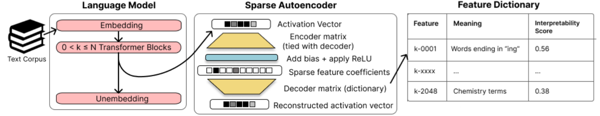
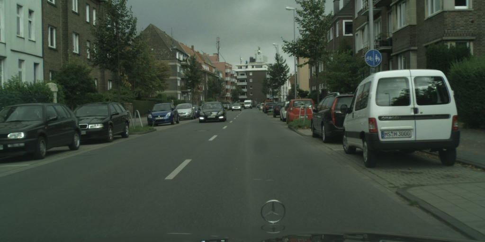
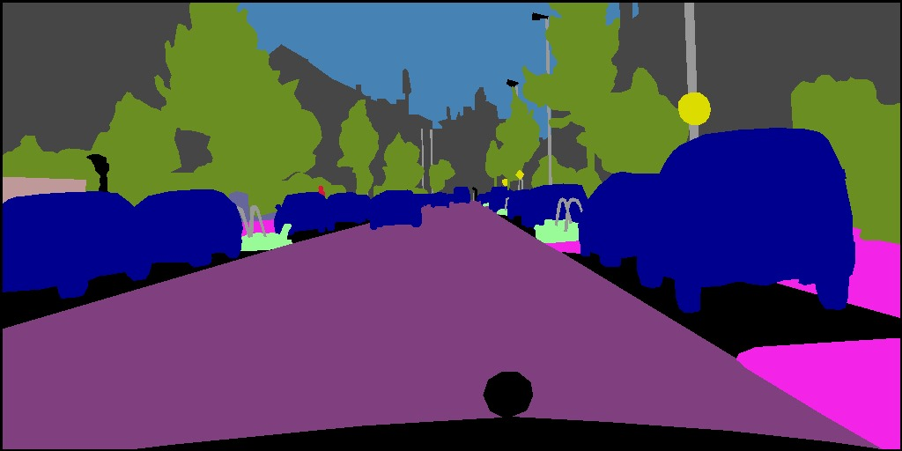

# Hi there 👋

Welcome to my GitHub profile!  
Here you can find some of my projects, mainly related to **AI, Data Science, Machine Learning, and Engineering**.  

---

## 🚀 Projects

### 🤔 [Mechanistic Interpretability of Vision Transformers](https://github.com/LeonardoSuperno/leonardosuperno/blob/main/report_s338685.pdf)
- **Description:** Investigated the internal representations of DINO Vision Transformers using BatchTopK and Matryoshka Sparse Autoencoders (SAEs). Compared CLS-only and spatial-token training strategies to analyze feature localization, semantic specialization, and layer-wise information aggregation. Results reveal a transition from localized patch-level representations to global semantic aggregation in deeper layers, demonstrating the potential of SAEs for uncovering interpretable visual concepts.

### 😠 [Sentiment Analysis and Sarcasm Detection](https://github.com/LeonardoSuperno/Figurative-Language-Understanding)
- **Description:** Evaluated encoder-based and generative language models (BERT and Mistral-7B) on sentiment analysis and sarcasm detection across British, Australian, and Indian English varieties using the BESSTIE benchmark. Explored Multitask Learning, Supervised Contrastive Learning, Data Augmentation, QLoRA Fine-Tuning, Few-Shot Prompting, and Probing techniques to improve model performance and robustness under resource-constrained settings.

### 🚗 [Real-time Domain Adaptation in Semantic Segmentation](https://github.com/LeonardoSuperno/SemSeg_MLDL25)
- **Description:** This work focuses on domain adaptation techniques for real-time semantic segmentation. We trained and evaluated a classical model (DeepLabV2) and a real-time model (BiSeNet) on the real-world Cityscapes dataset to establish baseline performance. We then trained BiSeNet on the synthetic GTA5 dataset and evaluated its generalization to Cityscapes, highlighting the impact of domain shift.  

  
  

- **More details:** [Complete Report](https://github.com/LeonardoSuperno/leonardosuperno/blob/main/Real-time%20Domain%20Adaptation%20in%20Semantic%20Segmentation.pdf)

---

### 🏥 [The Integrated Healthcare Timetabling Competition with Genetic Algorithm](https://github.com/LeonardoSuperno/IhtcGA)
- **Description:** This project tackles the Integrated Healthcare Timetabling problem, which combines surgical case planning, patient admission scheduling, and nurse-to-room assignment. We developed a solution based on a **genetic algorithm** to efficiently manage hospital scheduling.  

  

---

## 📫 Contact 
- LinkedIn: [Leonardo Superno Falco](https://www.linkedin.com/in/leonardo-superno-falco-00153a369/)
- Email: leonardo.superno@gmail.com
